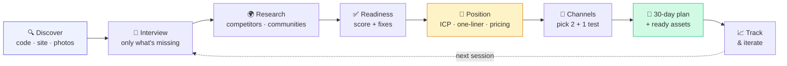
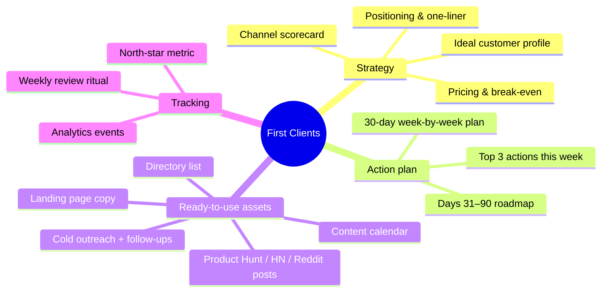
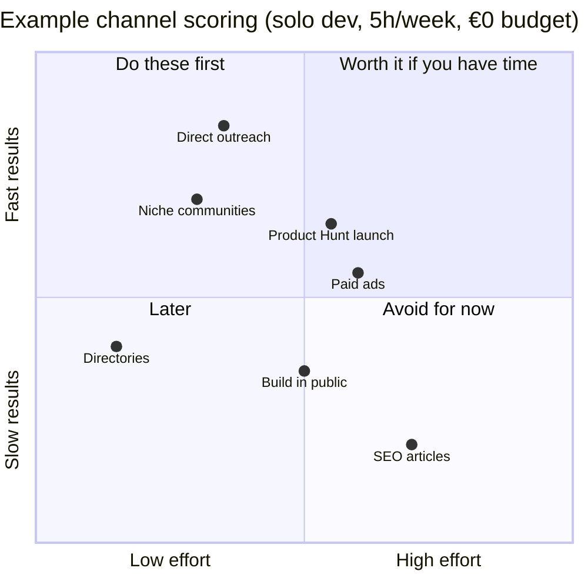

<div align="center">

# 🚀 First Clients

### A Claude skill that turns your product into a client-acquisition plan

**Built for solo developers and indie makers who can build great products, but don't know how to find the people who'll pay for them.**


</div>

---

## 🤔 The problem

You shipped the product. It works. And then... silence.

Most marketing advice is written for companies with a team, a budget and months to spare. You have **one person, a few hours a week, and very little money**.

**First Clients** is a marketing strategist built for that situation. It studies your actual product, asks you the right questions, researches your market, and gives you a **realistic 30-day plan with ready-to-use content**.

---

## ✨ What makes it different

| Generic marketing advice | First Clients |
|---|---|
| "Describe your product..." | **Reads your code**, visits your live site, looks at your photos |
| 50 generic questions | Only asks what it **couldn't figure out alone** |
| "Use social media" | Names the **exact subreddits, groups, shops and creators** |
| Plans for a 10-person team | Plans sized to **your hours and your budget** |
| Theory and frameworks | **Ready-to-send** emails, posts, landing copy, listings |
| Starts from zero every time | Saves a `marketing/` folder and **builds on it next session** |

---

## 🗺️ How it works



| Step | What happens | You get |
|---|---|---|
| **1. Discover** | Scans your repo (README, routes, models, pricing, SEO, analytics), audits your live site like a first-time visitor, and reviews your photos | A draft product profile |
| **2. Interview** | Asks 3–4 questions at a time: your customer, goals, **hours per week, budget**, and what you're comfortable doing | A plan that fits *you* |
| **3. Research** | Finds real competitors, mines their reviews for complaints, and finds where your customers hang out | Sourced market insights |
| **4. Readiness** | Rates how ready you are to market (0–10) and lists quick fixes with dev-hour estimates | A pre-launch fix list |
| **5. Position** | Defines your ideal customer, turns features into benefits, writes your one-liner, suggests pricing | Clear messaging |
| **6. Channels** | Scores channels on speed, cost, time, fit and your strengths, then commits to the best 2 | Focus instead of noise |
| **7. Plan + assets** | A week-by-week plan, plus copy you can use right away | Things you can send today |
| **8. Track** | Metrics, analytics setup, and a weekly review | A loop that improves |

---

## 📦 What you get at the end



Everything is saved in your repo, so the next session starts where you left off:

```
marketing/
├── product-profile.md   # what it is, features → benefits, readiness score
├── icp.md               # ideal customer, personas, where they hang out
├── competitors.md       # competitor table, complaint themes, sources
├── strategy.md          # positioning, pricing, channel scores
├── plan-30d.md          # week-by-week plan + this week's top 3
├── unit-economics.md    # physical products: cost per unit, margin, max CAC
├── results.md           # your numbers and learnings, session after session
└── assets/
    ├── landing-copy.md
    ├── outreach.md
    ├── launch-posts.md
    ├── content-calendar.md
    └── directories.md
```

You also get one **shareable strategy document** with an executive summary.

---

## 📡 Example: how it picks channels

The skill doesn't tell you to be everywhere. It scores each channel and picks the ones with the **fastest path to a first client for the least effort**:



*This is an illustration. Your chart depends on your product, time, budget and strengths.*

---

## 🧩 Works with many kinds of products

| Product type | Fit | What it focuses on |
|---|:---:|---|
| 💼 **B2B SaaS** | ⭐⭐⭐ | Precise ideal customer, LinkedIn + email outreach, demos, case studies |
| 📱 **B2C apps** | ⭐⭐⭐ | Communities, short-form content, app store optimization, referrals, local partners |
| 🛠️ **Developer tools** | ⭐⭐⭐ | Docs as marketing, GitHub, Show HN, dev communities, free tier |
| 🔄 **Marketplaces** | ⭐⭐⭐ | Win one side first, go hyper-local or niche |
| 🧑‍💻 **Freelance services** | ⭐⭐⭐ | Niche, portfolio, referrals, Malt/Upwork, productized offers |
| 🔌 **Hardware / electronics** | ⭐⭐ | Video demos, tech reviewers, crowdfunding, compliance |
| 👕 **Consumer goods** | ⭐⭐ | Photos, Instagram/TikTok, influencer seeding, Etsy, local shops |
| 🎨 **Handmade / artisan** | ⭐⭐ | Etsy, markets, founder story, limited editions |

### Physical products get their own track

When there's no code to read, the skill switches to a physical-product mode:

- 📸 **Photo audit**: online, your photos *are* your product
- 💶 **Unit economics**: cost per order, margin, the most you can spend to win a customer, break-even
- 🏪 **Physical channels**: your own store vs. Amazon/Etsy, pre-orders, crowdfunding, influencer seeding, local shops, fairs, wholesale
- 📋 **Compliance flags**: CE marking, product safety, labeling, return rights (to verify with an official source)
- 🛡️ **No big batches before demand is proven**: pre-orders and small runs come first

---

## ⚙️ Installation

### Claude.ai / Claude desktop app
1. Download this repo as a ZIP, or zip the `first-clients/` folder.
2. In Claude's **Settings**, open the **Skills** section and upload the zip.
3. Make sure the skill is turned on.

### Claude Code
```bash
git clone https://github.com/<your-username>/first-clients.git
cp -r first-clients/first-clients ~/.claude/skills/
```

---

## 💬 How to use it

Just ask Claude in plain words:

> *"Help me find my first clients for this app."*
> *"Build a marketing strategy for my product. Here's the repo and the live URL."*
> *"I make handmade leather wallets. How do I start selling them?"*

Or call it directly:

```
/first-clients
```

**Tips for the best results**
- 📁 Give Claude access to your **project folder** so it can read the code
- 🌐 Share your **live URL**
- 🖼️ Attach **screenshots or product photos**
- ⏱️ Be honest about your **hours per week and budget**. The plan depends on it.

### Two modes

| ⚡ Quick (~15 min) | 🧠 Full (~45 min) |
|---|---|
| Product summary | Everything in Quick, plus: |
| Positioning one-liner | Competitor & community research |
| Top 3 channels | Readiness score + fix list |
| 5 actions for this week | Pricing / unit economics |
| | 30-day plan + all assets + tracking |

---

## 🛡️ Built-in guardrails

- ✅ **Honest:** if your product isn't ready or the market looks weak, it says so
- ✅ **No invented data:** no fake stats, reviews or testimonials; it uses placeholders instead
- ✅ **Ethical tactics only:** no spam, no fake accounts, no undisclosed self-promotion, GDPR-friendly
- ✅ **Respects community rules,** so you don't get banned from the places where your users are
- ✅ **Never acts without you:** it drafts, and you decide what gets posted, sent or paid for

---

## ❓ FAQ

<details>
<summary><b>Do I need to be a marketer to use it?</b></summary>

No. It's made for developers. It explains things simply and gives you ready-made content instead of theory.
</details>

<details>
<summary><b>Does it work without code access?</b></summary>

Yes. It falls back on your live site, photos, specs and answers. Code access just makes it sharper for software.
</details>

<details>
<summary><b>Will it post or send things for me?</b></summary>

No. It drafts everything and you stay in control. Nothing is posted, sent or bought without your approval.
</details>

<details>
<summary><b>Does it work in other languages?</b></summary>

Yes. Customer-facing content is written in your target market's language, and the strategy in the language you use with Claude.
</details>

<details>
<summary><b>Can I use it more than once?</b></summary>

Yes, and you should. Come back with your numbers each week. It reads the `marketing/` folder and adjusts the plan.
</details>

---

## 🛣️ Roadmap

- [ ] Dedicated playbook for indie games (wishlists, streamers, festivals)
- [ ] Weekly review mode with automatic plan adjustments
- [ ] Email sequence templates for onboarding and retention
- [ ] More examples and sample outputs

Ideas and PRs are welcome. Open an issue!

---

## 📄 License

MIT. Use it, fork it, improve it.

<div align="center">

**Built by a solo developer, for solo developers.** ⭐ Star the repo if it helped you land your first clients!

</div>
